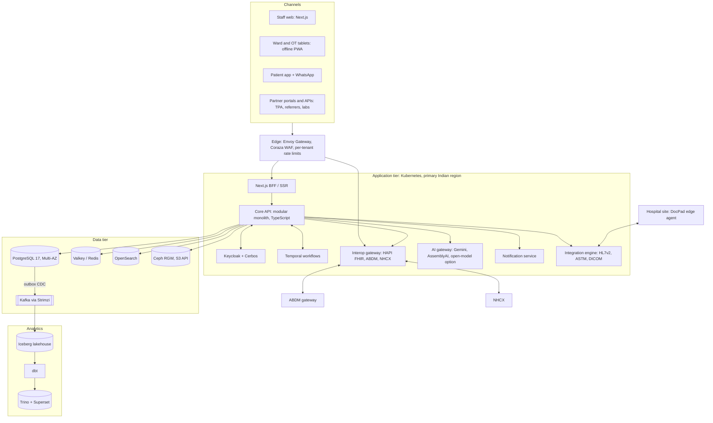
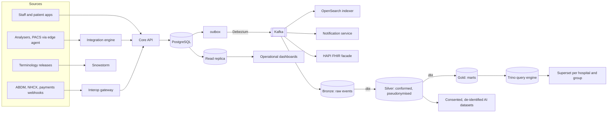
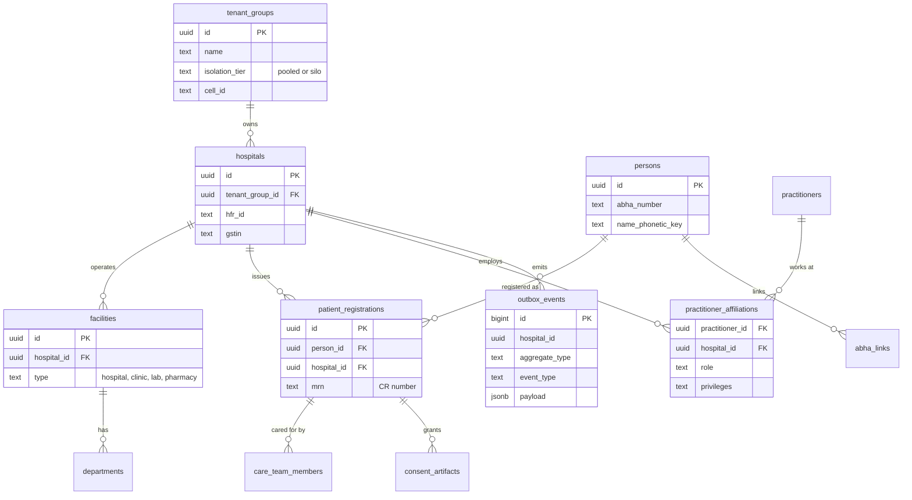
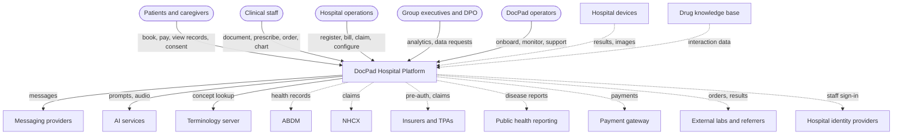
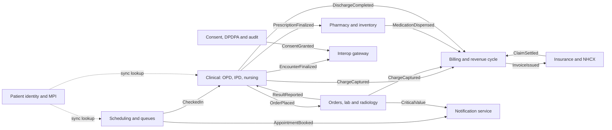
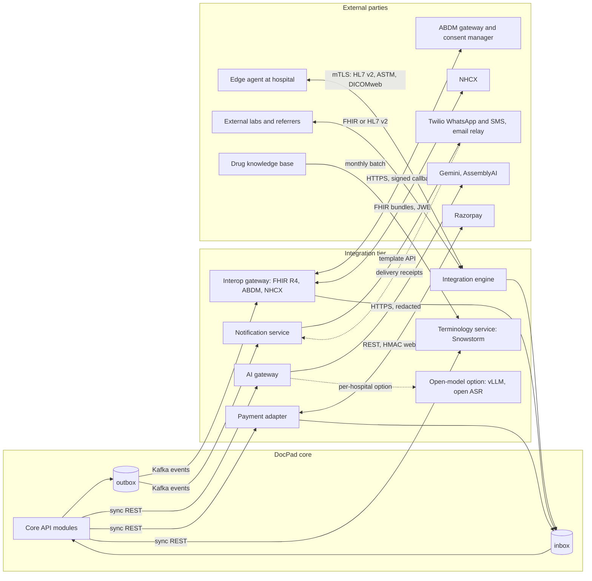
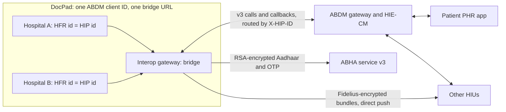
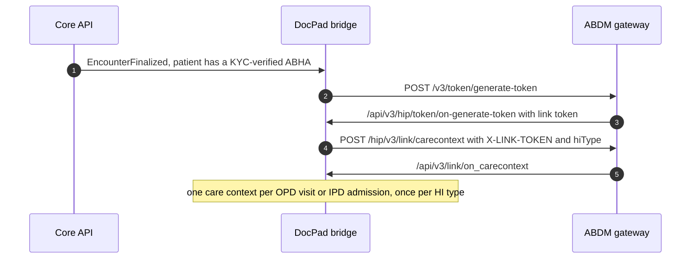
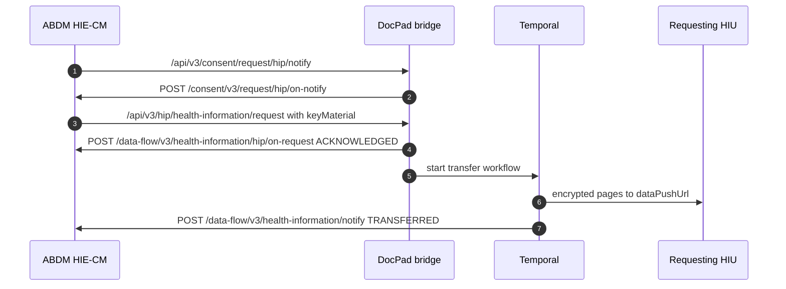
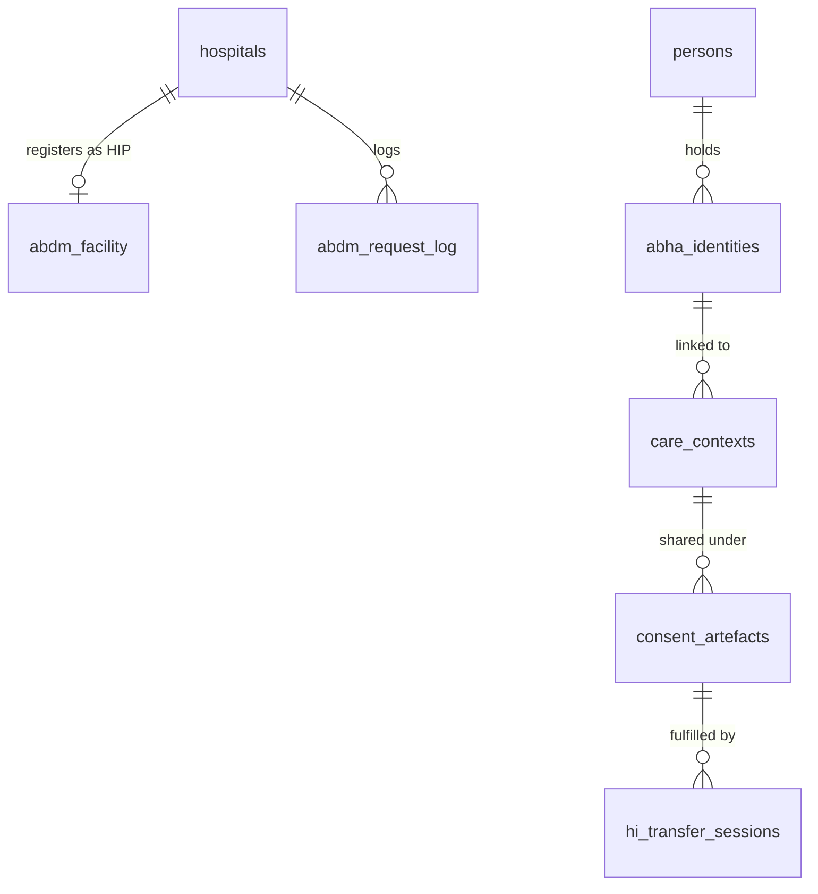

# DocPad Target-State Architecture

*Status: proposal. Written 17 Oct 2026 against commit `cfeaa1e`.*
*Companion visual: [`docpad-architecture.html`](./docpad-architecture.html), which contains the current-state map and the target-state diagrams.*

---

## 1. Purpose and scope

DocPad is a multi-tenant hospital information system for the Indian market. It covers registration, OPD, IPD, nursing, lab, pharmacy, billing, insurance, consent and ABDM interoperability.

Today it runs as one Next.js application on Vercel. One Supabase project is the entire backend.

That design was the right one for getting Phase 1 built. It is not the right design for running many hospitals' clinical records in production.

This document covers four things:

1. The target architecture DocPad should grow into.
2. The technology recommended for each component, with an interim option where moving straight to the target is not worth it yet.
3. How the target supports many hospitals, hospital groups and their patients at once.
4. The gaps between today and the target, and the order in which to close them.

Delivery is staged. A demo ships on 30 Oct 2026 and an MVP on 18 Dec 2026, both on today's stack. The target is then reached through continuous tracks (sections 10–11).

The design follows the six pillars of the AWS Well-Architected Framework and its SaaS Lens. It also follows the regulation DocPad operates under:

- the DPDP Act 2023 and its Rules
- ABDM and the NHA's technical standards
- NABH 6th Edition
- the CERT-In 2022 directions, which require incident reporting within 6 hours and logs kept in India for 180 days

---

## 2. Design assumptions

These figures size the target. Revisit them when the commercial plan changes.

| Dimension | 3-year planning figure |
|---|---|
| Hospitals (tenants) | 500, from 10-bed clinics to 500-bed groups |
| Hospital groups (chains) | 40 |
| Staff users | 50,000 named, 8,000 concurrent at peak |
| Patients | 20 million registrations |
| Encounters | 150,000 OPD and 15,000 IPD-days per day |
| Documents and images | 400 TB over 7 years, excluding DICOM archives hosted by hospitals |
| Data residency | All PHI stored in India. Approved providers (Gemini, AssemblyAI, Twilio) process PHI under contract; hospitals that require in-country processing use the open-model option |

The service levels below are targets, not current measurements.

| Service level | Target |
|---|---|
| Availability, clinical core (charting, prescribing, MAR) | 99.95% monthly |
| Availability, other modules | 99.9% monthly |
| Recovery point objective (RPO) | 5 minutes or less |
| Recovery time objective (RTO) | 1 hour or less for a region failure |
| API latency | p95 under 300 ms for reads, under 500 ms for writes |
| Patient search | p95 under 200 ms within a hospital group |
| Ward offline tolerance | 30 minutes of charting without connectivity |

---

## 3. Architectural principles

1. **Patient safety invariants live closest to the data.** Today's strongest property is that Postgres refuses a dangerous prescription, a change to a finalised encounter and an invoice that does not add up. Keep these rules in the database. Move workflow and orchestration out of it.
2. **Tenant context is explicit, everywhere.** Every request, event, log line, metric, cache key, object path and analytics row carries `tenant_group_id`, `hospital_id` and, where it applies, `facility_id`.
3. **One writer per aggregate.** Each domain module owns its tables. Other modules read through its API or its events, never by writing those tables directly.
4. **Events are a product.** Every state change that another module, a hospital or ABDM cares about becomes a versioned domain event. The event is written in the same transaction as the change, using an outbox table.
5. **Standards at the boundary, pragmatic models inside.** Internal tables stay relational and fast. FHIR R4 with the NRCES profiles is the shape used for interoperability, export and analytics conformance.
6. **Least privilege, defence in depth.** The edge checks the request, the identity provider authenticates the user, a policy engine authorises the action, and Postgres RLS is the final guard. Any one layer failing alone must not leak data.
7. **Evolve, don't rewrite.** The target is reached in phases. Each phase leaves a working system. The SQL safety and billing logic, the pgTAP suites and the data model are assets to keep.
8. **Everything is reproducible.** Infrastructure is OpenTofu, the schema is versioned migrations from a committed baseline, and every environment can be rebuilt from git.
9. **Open source first.** Every engine is OSI-licensed open-source software running on Kubernetes, so DocPad can run in any Indian cloud or data centre. Managed services are acceptable only when the engine underneath is open source and wire-compatible. The approved paid services are Twilio, Gemini and AssemblyAI; section 5 lists them with the few services that cannot be replaced.

---

## 4. Target architecture overview



### 4.1 Channels

| Channel | Users | Notes |
|---|---|---|
| Staff web (Next.js) | All hospital staff personas | Keeps today's React UI. Moves data access from direct supabase-js calls to the BFF. |
| Ward and OT tablet PWA | Nurses, OT team, ward doctors | Offline queue for vitals, MAR doses, I/O and notes, synced with conflict rules. Supports barcode wristband scanning. Designed for 10–11" screens, which closes the SOW tablet gap. |
| Patient app (Expo, iOS and Android) + WhatsApp | Patients, caregivers | ABHA or OTP login, bookings, reports, bills, payments, consent management, discharge instructions. WhatsApp handles notifications and simple flows. |
| Partner portals and APIs | TPAs and insurers, referring doctors, external labs, corporate panels | Scoped, audited access. Partners outside NHCX get FHIR APIs and webhooks. |

### 4.2 Edge

Envoy Gateway is the ingress. Coraza WAF runs the OWASP Core Rule Set, and Envoy enforces rate limits per tenant and per IP. Network-level DDoS scrubbing comes from the hosting provider, since no software can supply that capacity.

All origins are in India. TLS 1.3 is used everywhere. Partner and device traffic goes through API keys plus mTLS.

### 4.3 Identity and access

- **Authentication: Keycloak**, self-hosted in India. Open-source alternatives are Authentik and Zitadel.
  - One realm per deployment, with hospital groups as organisations.
  - Hospital chains can sign in through their own SAML or OIDC identity provider (SSO).
  - Clinicians must use MFA, through a TOTP app or a passkey.
  - Patients sign in with a mobile OTP or ABHA.
  - Sessions are short-lived JWTs with refresh tokens held only by the BFF, never in browser storage.
- **Authorisation: Cerbos**, as policy-as-code. The alternative is OpenFGA.
  - Policies combine role, hospital, facility, department and care relationship (for example, "the treating doctor of this admission").
  - Break-glass access lets a user override a restriction in an emergency. It requires a stated reason, sets a time limit and alerts the DPO.
  - Every authorisation decision is logged.
- **Database guard: Postgres RLS stays.** The Core API sets `app.hospital_id` and `app.user_id` in each transaction (`SET LOCAL`). The policies read those settings instead of `auth.uid()`. RLS becomes the backstop instead of the only line of defence.

### 4.4 Application tier

#### Core API: a modular monolith in TypeScript

Use NestJS with Kysely and generated types. It runs on Kubernetes in private network segments.

One deployable holds eight domain modules with enforced boundaries:

| Module | Owns |
|---|---|
| Patient identity and MPI | persons, registrations per hospital, duplicates and merges, ABHA links, photos |
| Scheduling and queues | slots, appointments, tokens, reception queue, reminders |
| Clinical | OPD encounters, IPD admissions, progress notes, orders, MAR, nursing tasks, discharge |
| Orders, lab and radiology | investigation orders, specimens, results, reports, PACS links |
| Pharmacy and inventory | formulary, stock, batches, dispensing, ward stock, procurement |
| Billing and revenue cycle | charge catalogue, charge items, invoices, payments, wallet, GST |
| Insurance | coverage, pre-authorisation, claims, NHCX exchange, TPA panels |
| Consent, privacy and audit | DPDPA consent, data-principal requests, ABDM consents, audit trail |

Why a modular monolith and not microservices: DocPad has one team and one product. Its domains share heavy transactional coupling, for example encounter to charge to invoice. Microservices would add network failure modes and distributed transactions without any benefit at this size. Module boundaries keep the option to extract a service later. The likely first candidates are Interop and Integration.

Today's SQL functions split into two groups:

- **Stay in the database:** the invariants. These are the safety blocks, the finalised-encounter lock, the invoice arithmetic, the number sequences and RLS.
- **Move to the Core API:** orchestration. This means auto-billing chains, task generation, notifications and FHIR building, so that it can be tested, traced and versioned.

#### Next.js BFF

The BFF does server-side rendering and UI composition, and keeps the session. It pushes live queues (bed board, lab queue, reception) to clients over server-sent events, fed from Kafka through Redis pub/sub. This replaces direct Supabase Realtime subscriptions from the browser.

#### Temporal workflows

Temporal runs long, multi-party processes that must survive restarts and retries. It is self-hosted (MIT licence).

- pre-authorisation to claim to settlement
- discharge, where clinical sign-off, billing clearance, pharmacy return and bed release run in parallel
- the ABDM consent lifecycle
- appointment reminder campaigns
- tenant onboarding

#### Supporting services

- **Interop gateway.**
  - A HAPI FHIR R4 server acts as a read facade with NRCES profiles. It is fed from domain events and is never the system of record.
  - It implements the ABDM HIP, HIU and HRP roles (milestones M1–M3), including the encrypted health-information transfer.
  - It includes an NHCX client for cashless claims.
- **AI gateway.**
  - It is the single exit for all model calls. It removes identifiers before text leaves DocPad, sets quotas and keeps cost records per tenant, logs prompts and responses (with PHI redacted) and runs model evaluations.
  - Models:
    - Gemini (approved) for extraction, summaries, OCR and embeddings, preferably through Vertex AI with no-training terms and a regional endpoint where offered.
    - AssemblyAI (approved) for speech-to-text.
    - Open-weight models (Apache-2.0 or MIT), served by vLLM on GPU nodes in India, as a per-hospital option selected in the gateway.
    - The contracted in-house speech-to-text model: a medical ASR fine-tuned for Indian accents, hosted on GPU nodes in India (Whisper-family or AI4Bharat Indic models). It is delivered through the open-model option.
  - Every AI-extracted clinical fact stays a draft until a clinician confirms it.
- **Notification service.**
  - Channels: WhatsApp and DLT-registered SMS through Twilio (approved), email through self-hosted Postal or any SMTP relay, and push through FCM and APNs. Orchestration runs on Novu (MIT).
  - It uses templates in multiple languages (English, Hindi and regional), checks consent and quiet hours, and keeps delivery receipts.
- **Integration engine.**
  - Adapters for HL7 v2 and ASTM lab analysers, DICOM through Orthanc with an OHIF viewer, and results from external labs.
  - On the hospital side, a DocPad edge agent (a small container on the hospital LAN) connects to the analysers, PACS and label printers.
  - The agent stores and forwards data when the internet connection drops.

### 4.5 Data tier

| Store | Role |
|---|---|
| PostgreSQL 17 (CloudNativePG operator, HA across zones) | System of record. RLS on tenant keys, pgvector (HNSW), pg_trgm. Large time-series tables are partitioned with pg_partman, for example audit, vitals, MAR and notifications. Connections go through PgBouncer. Read replicas serve operational reporting. |
| Valkey (BSD, Redis-compatible) | Cache for reference data and terminology, rate limits, idempotency keys, distributed locks for bed allocation and token numbers, and pub/sub for live boards. Holds no PHI longer than 15 minutes. |
| OpenSearch | Patient search with phonetic and transliterated Indian-name matching, terminology search, and search over staff and inventory. Indexed from Kafka. |
| Ceph RGW via Rook (S3 API), encrypted with OpenBao-managed keys | Documents, scans, consent PDFs, wound photos, exports and backups. Paths are prefixed per tenant. Object Lock keeps medico-legal records for the retention period. Lifecycle rules move cold data to a cheaper pool. |
| Apache Kafka (Strimzi operator) | The domain event backbone. A transactional outbox plus Debezium CDC publishes every change in commit order. One topic per domain, keyed by `hospital_id`. |

### 4.6 Analytics

Operational dashboards query the Postgres read replica through materialised views and stay inside a single hospital. Network and group analytics, and anything that joins across hospitals, run in the lakehouse.

The lakehouse is described in section 6.

### 4.7 Platform

| Concern | Target |
|---|---|
| Infrastructure as code | OpenTofu, one module per cell; Argo CD for GitOps deployment |
| Environments | dev, staging (anonymised production-shaped data), prod; ephemeral preview environments per PR with a database branch |
| CI/CD | GitHub Actions: typecheck, lint, unit, pgTAP (against staging, never prod), contract tests, migration drift gate, container scan (Trivy), SAST (Semgrep), blue/green deploy |
| Schema | Committed baseline + versioned SQL migrations (Atlas or Supabase CLI); generated TypeScript types; drift check blocks merge |
| Feature flags | OpenFeature with Unleash; per-tenant module flags replace `hospitals.enabled_modules` |
| Observability | OpenTelemetry SDK in every service → Prometheus, Grafana, Loki, Tempo; GlitchTip for front-end and API errors (Sentry SDK compatible); Uptime Kuma; SLO dashboards per module and per tenant |
| Security operations | Wazuh SIEM, Falco runtime detection, Trivy and Semgrep CE in CI; log retention ≥ 180 days in India (CERT-In); quarterly VAPT; ISO 27001 then SOC 2 Type II |
| Secrets and keys | OpenBao (secrets and transit encryption); envelope encryption; per-tenant data keys for highly sensitive columns; nothing secret ever in a `NEXT_PUBLIC_*` variable |
| Disaster recovery | CloudNativePG replica cluster in a second Indian region; WAL archiving with Barman; Ceph multi-site replication; quarterly restore drills per tenant |

---

## 5. Recommended technology by component (open source first)

Every engine in the target is OSI-licensed open-source software running on Kubernetes. This gives DocPad three properties:

- It runs in any Indian cloud or a hospital group's own data centre.
- It depends on no vendor-proprietary API.
- PHI stays on infrastructure DocPad controls, except where an approved provider (Twilio, Gemini, AssemblyAI) processes it under contract.

A managed service is acceptable only when the engine is open source and wire-compatible, such as managed Kubernetes or managed vanilla PostgreSQL. Leaving it then stays possible.

The MVP still runs on the interim stack, Supabase and Vercel. Supabase is itself Apache-2.0 and can be self-hosted.

| Component | Open-source choice | Licence | Replaces | Notes |
|---|---|---|---|---|
| Runtime platform | Kubernetes + Argo CD (GitOps) | Apache-2.0 | ECS Fargate | Any Indian cloud or on-premises |
| Edge, WAF, rate limits | Envoy Gateway + Coraza WAF (OWASP CRS) | Apache-2.0 | CloudFront, AWS WAF | DDoS scrubbing stays with the network provider |
| Certificates, mTLS | cert-manager | Apache-2.0 | ACM | Partner and edge-agent mTLS |
| Staff UI | Next.js, React, Tailwind, Radix on a self-hosted Node server | MIT | Vercel hosting | Same code |
| Patient app | Expo / React Native | MIT | — | Shares TypeScript models |
| Core API | NestJS + Kysely | MIT | — | Typed modules |
| Identity | Keycloak | Apache-2.0 | Cognito, Supabase Auth | SSO, MFA, patient OTP |
| Authorisation | Cerbos | Apache-2.0 | — | Policy as code |
| Workflows | Temporal (self-hosted) | MIT | Step Functions | Durable multi-day processes |
| Background jobs | Graphile Worker or pg-boss on Postgres | MIT | SQS | Transactional with the data |
| OLTP database | PostgreSQL 17 + CloudNativePG | PostgreSQL, Apache-2.0 | Aurora | Keeps all SQL, tests, RLS |
| Pooling | PgBouncer | ISC | RDS Proxy | Per-tenant connection budgets |
| Backups, PITR | Barman (via CloudNativePG) or pgBackRest | GPL-3.0, MIT | Managed snapshots | WAL archive in a second region |
| Cache | Valkey | BSD-3 | ElastiCache, Redis | Open Redis fork |
| Search | OpenSearch (operator) | Apache-2.0 | Amazon OpenSearch | Phonetic Indian names |
| Vectors | pgvector (HNSW) | PostgreSQL | — | Embeddings next to their rows |
| Object storage | Ceph RGW via Rook (S3 API) | LGPL, Apache-2.0 | S3 | Object Lock; any S3-compatible store works |
| Events and CDC | Apache Kafka (Strimzi) + Debezium | Apache-2.0 | MSK, Confluent | Ordered, replayable events |
| Secrets and keys | OpenBao | MPL-2.0 | Secrets Manager, KMS | Open fork of Vault (now BSL) |
| Terminology | Snowstorm | Apache-2.0 | CSIRO Ontoserver | SNOMED content licensed; free in India via NRCeS |
| FHIR | HAPI FHIR server + HL7 validator | Apache-2.0 | — | NRCES conformance |
| Integration engine | Apache Camel + HAPI HL7 v2 | Apache-2.0, MPL | — | Analysers, external labs |
| Imaging | Orthanc + OHIF | GPL-3.0, MIT | — | Separate service |
| ABDM encryption | fidelius-cli (sidecar) | open source | — | Reference Fidelius implementation |
| LLM | **Gemini** (approved) behind a LiteLLM gateway; open-weight models on vLLM as a per-hospital option | commercial; MIT, Apache-2.0 | Gemini key in the browser | Gateway redacts, logs, sets quotas, routes per hospital |
| Speech-to-text | **AssemblyAI** (approved); Whisper-family or AI4Bharat Indic ASR as the open option | commercial; MIT | — | The open option is the route to the SOW in-house STT |
| OCR | **Gemini** vision (approved); PaddleOCR or docTR as the open option | commercial; Apache-2.0 | — | Lab reports, insurance cards |
| Embeddings | **gemini-embedding-001** (current); open embedding models (e.g. BGE, E5) as the option | commercial; MIT / Apache-2.0 | — | Raise the Gemini quota to finish the ICD-10 backfill; switching models means re-embedding 73,790 codes |
| Notifications | Novu (self-hosted) orchestrating **Twilio** (approved) for WhatsApp and DLT SMS | MIT; commercial | Direct Twilio calls from route handlers | Templates, preferences, consent in one place |
| Email sending | Postal (self-hosted) | MIT | SES, Resend | Or any SMTP relay |
| Lakehouse | Apache Iceberg + Apache Polaris or Nessie catalog | Apache-2.0 | Snowflake storage | Open table format |
| Query engine | Trino | Apache-2.0 | Snowflake, Redshift | Group and network analytics |
| Transform, quality | dbt Core, Great Expectations | Apache-2.0 | — | Tested SQL models |
| BI | Apache Superset (embedded, RLS) | Apache-2.0 | — | Per hospital and group |
| Catalog, lineage | OpenMetadata | Apache-2.0 | — | PII tags, lineage |
| Metrics, logs, traces | OpenTelemetry, Prometheus, Grafana, Loki, Tempo | Apache-2.0, AGPL-3.0 | Datadog | End-to-end traces |
| Error tracking | GlitchTip | MIT | Sentry SaaS | Uses the Sentry SDK |
| Uptime | Uptime Kuma | MIT | — | Per-tenant checks |
| Security monitoring | Wazuh, Falco | GPL-2.0, Apache-2.0 | GuardDuty, Security Hub | CERT-In log retention |
| Infrastructure as code | OpenTofu | MPL-2.0 | Terraform (BSL) | Open fork |
| Supply-chain scanning | Trivy, Semgrep CE | Apache-2.0, LGPL | — | Images, dependencies, code |
| Feature flags | Unleash + OpenFeature | Apache-2.0 | — | Per-tenant module flags |

### 5.1 Paid services in the target

Twilio, Gemini and AssemblyAI are approved choices. The rest are external services or licensed content by nature. Each one sits behind an adapter.

| Item | Why it stays a service | How lock-in is limited |
|---|---|---|
| Payment gateway (Razorpay) | RBI-licensed payment aggregators | Payment adapter; a second gateway can be added |
| Twilio (WhatsApp, SMS) | Approved; carries Meta and DLT registration | Novu provider; DocPad owns templates and sender registrations |
| Gemini (LLM, OCR, embeddings) | Approved | LiteLLM gateway; per-hospital switch to open models |
| AssemblyAI (speech-to-text) | Approved | AI gateway; open ASR option |
| Push (FCM, APNs) | Apple and Google | Novu providers |
| ABDM, NHCX, IDSP/IHIP, Nikshay | Government platforms | Interop gateway |
| DDoS scrubbing, anycast CDN | Needs network capacity | Stateless; any provider |
| Compute, network, data centre | Hardware | Kubernetes and OpenTofu run on any provider with two Indian regions |
| SNOMED CT content, drug knowledge base | Licensed clinical content (SNOMED free in India) | Loaded into Snowstorm and versioned tables |
| Source hosting and CI (GitHub) | Developer tooling, not runtime | Forgejo + Woodpecker CI is the open alternative |

### 5.2 Licence notes

- **Avoided because the licence is not open source:** Terraform and Vault (BSL), Sentry (FSL), Redis 7.4 (RSAL/SSPL), Snowflake, Aurora, and MinIO (AGPL, with the community edition reduced by the vendor).
- **AGPL and GPL components** (Grafana, Loki, Tempo, Orthanc, Wazuh) run unmodified as separate internal services. Used this way, they create no obligation to publish DocPad code. Get counsel review before modifying any of them.
- **Open-model option:** use only models licensed Apache-2.0 or MIT. Several popular model licences restrict commercial use.
- **Approved providers and the DPDP Act:** Gemini, AssemblyAI and Twilio may process PHI outside India. Sign data-processing agreements with no-training terms, use regional endpoints where offered (Vertex AI for Gemini), and list each one as a processor in the privacy notice. Audio cannot be redacted before speech-to-text, so a hospital that forbids it uses the open ASR option.
- **The trade-off is operations.** Self-hosting moves work from vendors to DocPad's platform team. Budget for at least two SRE/platform engineers before Phase 3, and use managed Kubernetes and managed vanilla PostgreSQL where that load is too high.

---

## 6. Target data architecture

### 6.1 Flow



### 6.2 Layers

| Layer | Contents | Access |
|---|---|---|
| Operational (Postgres) | Normalised tables, one owner module each | Core API only; RLS backstop |
| Read replica | Materialised views for today's ~30 `get_*` analytics | Hospital-scoped dashboards |
| Bronze | Raw CDC events, immutable, partitioned by `hospital_id` and date | Data engineering only |
| Silver | Conformed entities shaped like FHIR resources. Patient identifiers replaced by keyed tokens. Free text classified. | Analysts with a purpose; no direct identifiers |
| Gold | Marts for revenue cycle, OPD flow, bed occupancy and length of stay, NABH quality indicators, pharmacy consumption and expiry, insurance turnaround | BI with row-level security per tenant and group |

### 6.3 Data governance

- **Classification:** every column is tagged in OpenMetadata as one of PHI-direct, PHI-indirect, financial, operational or reference. The pipelines enforce the tags.
- **Consent-aware processing:** silver and gold exclude patients whose DPDPA purpose consent (for example `research_anonymised`) is missing or withdrawn. ABDM sharing reads the consent artefact before each transfer.
- **Retention:** `hospitals.data_retention_years` is enforced by a scheduled workflow. Data past retention is archived to Glacier with Object Lock, then purged when legally allowed. Medico-legal holds override purging.
- **Data quality:** dbt tests and Great Expectations checks run on silver. Failures block the publication of gold.
- **Lineage:** column-level lineage from the source table to the dashboard tile.

### 6.4 Data model evolution

These changes are additive and can be migrated in phases.



Key changes:

1. **Remove the split between `organizations` and `hospitals`.** `hospitals` becomes the single tenant table, and the old foreign keys are pointed at it.
2. **Separate a person from a patient registration.** `persons` is the identity across the platform. `patient_registrations` holds each hospital's MRN or CR number.
   - A group-level master patient index (MPI) links the same person across the group's hospitals.
   - Records are shared across hospitals only with consent, or within a group whose privacy notice covers it.
3. **Let one practitioner work at several hospitals.** `practitioner_affiliations` replaces the single `practitioners.hospital_id`. Visiting consultants are common in India, and today they need a separate account at each hospital.
4. **Add `facilities`** for branches, collection centres and satellite pharmacies under one hospital.
5. **Make care relationships explicit** with `care_team_members`, which the authorisation policies use.
6. **Add `outbox_events`**, written in the same transaction as every domain change.
7. **Commit the baseline DDL** for all tables. Generate types. Delete or retire the 173 archived migration files.

---

## 7. Multi-hospital operation

### 7.1 Tenant hierarchy

```
Platform (DocPad)
 └─ Cell (a full copy of the stack in one region; holds N hospital groups)
     └─ Tenant group (hospital chain or single-hospital owner; billing customer)
         └─ Hospital (legal entity: HFR ID, GSTIN, NABH status, letterhead)
             └─ Facility (branch, clinic, lab, pharmacy)
                 └─ Department / ward / OT
```

### 7.2 Isolation tiers

| Tier | Who | Database | Compute | Notes |
|---|---|---|---|---|
| Pooled | Clinics and small to mid hospitals (default) | Shared PostgreSQL cluster in a cell; RLS on `hospital_id` | Shared | Lowest cost; noisy-neighbour limits apply |
| Silo | Large groups, or contracts that require it | Dedicated PostgreSQL cluster | Shared or dedicated workers | Same code and schema; tenant catalog routes connections |
| Self-hosted edge | Any hospital | n/a | DocPad edge agent on the LAN | Devices, printers, offline cache |

A **tenant catalog**, a small platform database, maps each hospital to its cell and its database. The BFF and the Core API look up this mapping at login and cache it in Valkey.

Moving a tenant from the pooled tier to the silo tier is a scripted operation. It uses logical replication filtered by `hospital_id`, then a cutover.

### 7.3 What changes for operations

| Operation | How the target supports it |
|---|---|
| Onboarding a hospital | A Temporal workflow creates the tenant, cell mapping and Keycloak organisation, and seeds the master data from a versioned catalogue: charge definitions, wards, formulary, templates, consent forms. It then configures the letterhead and modules and invites the admins. Goal: under 1 day without engineering help. |
| Per-hospital configuration | Feature flags per tenant, price lists, tax settings, languages, numbering formats, clinical templates and approval rules, all held as versioned configuration rather than code. |
| Hospital groups | Group-level roles, such as a group CMO, see aggregated dashboards. They see patient detail only through a care relationship or break-glass. |
| Shared patients across a group | The group MPI links registrations. The clinician sees the history from other branches when consent allows, with the source hospital labelled. |
| Visiting consultants | One login and several affiliations. The user picks the hospital context, and every action is scoped to it. |
| Noisy neighbours | Per-tenant API rate limits, statement timeouts, a connection budget per tenant in PgBouncer, and queue partitions by `hospital_id`. |
| Support access | Support staff request time-boxed access that the hospital admin approves. It is fully audited and visible to the hospital. |
| Per-tenant backup, restore and export | Logical export per `hospital_id` (FHIR bulk export plus documents), used for DPDPA portability, contract exit and point-in-time restore of a single tenant. |
| Metering and SaaS billing | Usage events (encounters, beds, AI minutes, messages) are aggregated per tenant to bill DocPad's customers. |
| Releases | Ring deployment: internal tenant, then pilot hospitals, then everyone. Feature flags decouple deploying code from turning features on. |
| Incidents | SLOs and alerts per tenant. A status page. A CERT-In 6-hour reporting runbook. The DPO is notified for any PHI exposure. |

---

## 8. Personas

DocPad today routes six staff roles (doctor, nurse, pharmacist, receptionist, lab, admin) and has a public prescription page. The target adds the personas below. Each persona is a set of policies in Cerbos, not a hard-coded string.

| Persona | Channel | Core jobs | Data scope |
|---|---|---|---|
| Doctor (OPD consultant) | Web, tablet | Queue, consult, voice notes, prescribe, order, refer, follow-up | Own patients plus department; history across the group with consent |
| Doctor (IPD / intensivist) | Web, tablet | Rounds, progress notes, orders, consults, discharge | Admitted patients on own service |
| Visiting consultant | Web, tablet | Consults at several hospitals | Per-affiliation, per-consult |
| Surgeon / anaesthetist | Tablet | PAC, OT schedule, safety checklist, op notes, implants | Scheduled surgical patients |
| Nurse (ward / ICU) | Tablet PWA, offline | MAR, vitals, I/O, tasks, handover, wound care | Assigned ward and shift |
| Nursing superintendent / ward in-charge | Web | Staffing, bed board, quality audits, escalations | All wards in hospital |
| Front desk / registration | Web | Registration, duplicate resolution, booking, tokens, check-in | Demographics, schedule |
| Billing / cashier | Web | Charges, invoices, payments, refunds, shift reconciliation | Financial records; no clinical notes |
| Insurance / TPA desk | Web | Coverage, pre-auth, claims, NHCX, query responses | Coverage, claims, the clinical extracts claims require |
| Lab technician | Web, edge agent | Sample collection, analyser results, validation | Orders and results for own lab |
| Pathologist / radiologist | Web, PACS viewer | Reporting, sign-off, critical-value calls | Orders and images for own department |
| Pharmacist | Web | Dispense, substitution, returns, stock | Prescriptions and inventory |
| Store / procurement manager | Web | Indents, purchase orders, vendors, expiry | Inventory, vendors |
| Medical records officer (MRD) | Web | Coding (ICD-10), record completeness, release of information | Records hospital-wide; release audited |
| Quality / infection control officer | Web | NABH indicators, incident reports, HAI surveillance | De-identified quality data, incident records |
| Hospital admin / medical superintendent | Web | Staff, masters, pricing, operational dashboards | Hospital-wide configuration and reports |
| Group executive (CXO) | Web, mobile | Network analytics, benchmarking | Aggregated group data only |
| Data protection officer / grievance officer | Web | DPDPA requests, consent register, breach workflow | Consent and request records, audit logs |
| Patient | App, WhatsApp, web | Book, pay, view reports and prescriptions, manage consent, link ABHA | Own records |
| Caregiver / guardian | App | Act for a minor or dependent patient | Delegated records, time-bound |
| Referring doctor | Partner portal | Refer, receive discharge summaries and results | Referred patients only |
| TPA / insurer | NHCX, partner API | Adjudicate pre-auth and claims | Claim bundles they are party to |
| External lab / diagnostic partner | Partner API | Receive orders, return results | Orders sent to them |
| DocPad platform operator (SRE / support) | Internal console | Tenant onboarding, incidents, support | Metadata by default; PHI only with approved, audited access |

---

## 9. Well-Architected review: current vs target

| Pillar | Current state | Target practices |
|---|---|---|
| **Operational excellence** | No staging; CI pgTAP runs against prod and passes green when the secret is missing; `console.*` only; migrations drifted, no generated types; cron secret unset | dev/staging/prod plus previews; IaC; drift gate blocks merge; OpenTelemetry + SLOs; runbooks; game days; ring deployments with flags |
| **Security** | RLS strong and tested; append-only audit; but browser talks to DB directly; Gemini key shipped to browser and not rotated; no MFA; public buckets for templates and assets; admin client falls back to anon key; PHI to third-party AI under consumer terms | WAF; Keycloak with MFA and SSO; Cerbos policies + RLS backstop; secrets only server-side and rotated; KMS envelope encryption; AI gateway with redaction; private buckets with signed URLs; SIEM; VAPT; ISO 27001 |
| **Reliability** | Single project, single region; backups cannot be decrypted; no queue, retries happen inside requests; ECG service not deployed; one missing edge function | Multi-AZ, cross-region DR (RPO 5 min, RTO 1 h); restore drills; outbox + Kafka; Temporal retries; DLQs; offline ward PWA; edge agent store-and-forward; dependency health checks |
| **Performance efficiency** | Analytics run as live RPCs on the OLTP primary; ILIKE search; no cache; ~90 triggers on the write path | Read replicas and materialised views; OpenSearch; Valkey; partitioned time-series tables; orchestration moved off triggers; load tests per release |
| **Cost optimisation** | Low today; unbounded AI calls; no per-tenant cost visibility | Per-tenant cost allocation tags and metering; AI quotas; storage lifecycle tiers; ARM nodes; committed-use discounts; no per-seat licence fees |
| **Sustainability** | Not considered | Right-sized cells, ARM nodes, cold-storage tiering, small open models where they suffice |

---

## 10. Delivery plan: demo, MVP, then continuous evolution

### 10.1 Dates and approach

| Milestone | Date | What it means |
|---|---|---|
| Demo | **Fri 30 Oct 2026** (2 weeks) | One scripted patient journey on a separate demo project with seeded data |
| MVP live | **Fri 18 Dec 2026** (9 weeks) | One to three pilot hospitals on real patients |
| Target state | Continuous from Jan 2027 | Reached track by track, behind feature flags, while product work continues |

Neither date leaves room to re-platform. The demo and the MVP ship on **today's stack**, Supabase and Vercel (the "interim" column in section 5). They include the safety, security and multi-hospital fixes a real hospital needs.

The target architecture in sections 4–7 does not change. Only its sequencing does: it is reached incrementally after launch.

Planning assumption: 3–4 engineers, 1 QA, and a product owner available for UAT.

### 10.2 Demo (weeks 1–2)

The demo runs one patient through the modules that already work. Unfinished screens are hidden per hospital through `hospitals.enabled_modules`, not shown as stubs.

| Step | Persona | What the audience sees |
|---|---|---|
| 1 | Front desk | Register a patient, catch a duplicate, book, issue a token |
| 2 | Doctor | OPD consult with voice dictation, SNOMED diagnosis, vitals |
| 3 | Doctor | Prescribe; an allergy hard stop fires; finalise and lock the encounter |
| 4 | Patient | WhatsApp prescription and the `/rx` link |
| 5 | Pharmacist | Dispense from stock |
| 6 | Lab | Enter a result from a photographed report (OCR) |
| 7 | Billing | Auto-generated invoice, payment, shift reconciliation |
| 8 | Admin | Operational dashboard and the audit trail of every step above |

| Week | Work |
|---|---|
| W1 · 19–23 Oct | Dump the production schema to a committed baseline (`scripts/build-baseline-migration.mjs`). Create a demo/staging Supabase project from it. Seed it with `npm run seed:demo`. Rotate the exposed Gemini and service-role keys. Run the script end to end and log every break. Apply for NHA ABDM sandbox access. |
| W2 · 26–30 Oct | Fix breaks on the golden path only. Remove the nested header in the encounter workspace. Hide stub routes and `/admin/analytics/clinical`. Set `CRON_SECRET`. Do two dry runs, then the demo. |

### 10.3 MVP (weeks 3–9)

**Definition.** One to three pilot hospitals use DocPad on real patients for:

- registration
- OPD
- prescribing
- pharmacy
- lab
- billing
- basic IPD with nursing

Each hospital is onboarded without engineering help. Every clinical write is safe, audited and recoverable.

| Workstream | Weeks | Scope |
|---|---|---|
| Security | W1–W4 | Keys rotated (W1); Supabase Auth TOTP MFA enforced for clinicians and admins in `proxy.ts`; public buckets made private with signed URLs; remove the anon-key fallback in `lib/supabase/admin.ts` |
| Operations | W2–W4 | GlitchTip error tracking (Sentry SDK) and Uptime Kuma alerts; CI pgTAP suites against staging only; baseline DDL and generated types committed; Supabase PITR enabled and the custom backup code retired; one restore drill |
| Clinical safety | W3–W6 | AI extractions stay drafts until a doctor confirms them (`doctor_confirmed`); licensed or substantially expanded drug-interaction content; discharge summary modal pointed at the existing compile route |
| Routes and RBAC | W3–W6 | One canonical route tree; proxy denies by default (covers `/ipd`); tablet layouts for nursing screens |
| Multi-hospital | W4–W7 | Merge `organizations` into `hospitals`; scripted onboarding that seeds master data from a versioned catalogue; per-hospital configuration screen |
| IPD, lab, billing, insurance | W4–W8 | Admit → notes → MAR → discharge → final bill; pre-auth and claim forms (manual submission) |
| Notifications | W5–W6 | WhatsApp reminders and invite emails working |
| ABDM v3 M1 + M2 (sandbox) | W1–W8 | Fix the live ABDM bugs (section 17.6). Build ABHA enrolment, verification and Scan & Share, then HIP linking and data push, against the NHA sandbox. Production certification follows after the MVP. |
| Launch | W7–W9 | UAT with the pilot hospital, load test, security review, go-live runbook. Code freeze at the end of W8. |

### 10.4 Priorities, re-ranked for the dates

**Demo** means due 30 Oct, **MVP** means due 18 Dec, and **Post-MVP** means continuous.

| When | Gap | Fix |
|---|---|---|
| Demo | No staging; core DDL missing from repo | Baseline dump → demo/staging project |
| Demo | Exposed Gemini and service-role keys | Rotate; remove `NEXT_PUBLIC_GEMINI_API_KEY` |
| Demo | Nested app chrome; stub and broken routes | Fix chrome; hide unfinished modules per hospital |
| Demo | Reminders never sent | Set `CRON_SECRET` |
| MVP | Backups cannot be restored | Supabase PITR; restore drill |
| MVP | No MFA | Supabase Auth MFA |
| MVP | AI output enters the chart unconfirmed | Confirmation step |
| MVP | 24 drug-interaction pairs | Licensed knowledge base (decision by W3) |
| MVP | Missing `generate-discharge-summary` | Use the existing compile route |
| MVP | Duplicate routes; `/ipd` outside the proxy | One tree; deny by default |
| MVP | No observability; CI tests hit production | GlitchTip and alerts; CI on staging |
| MVP | `hospitals` / `organizations` split | Merge; scripted onboarding |
| MVP | No tablet layouts | Nursing screens at 10–11" |
| MVP | ABDM not running; live ABDM bugs | Fix the bugs; v3 M1 + M2 in sandbox; certification after the MVP |
| Post-MVP | Browser writes directly; orchestration in triggers | BFF + Core API (strangler), outbox, Kafka |
| Post-MVP | One hospital per practitioner; no SSO | Keycloak, Cerbos, affiliations |
| Post-MVP | Analytics on the primary | Read replica, then Iceberg lakehouse + Trino |
| Post-MVP | No devices, patient app, payments, NHCX | Edge agent, Expo app, Razorpay, NHCX |
| Post-MVP | External terminology; plain-text phones; retention unenforced | Snowstorm; tokenisation; retention workflow |
| Post-MVP | Single region | Kubernetes cells in two Indian regions |

### 10.5 Risks to the dates

| Risk | Effect | Mitigation |
|---|---|---|
| NHA sandbox approval (weekly committee, 7–10 days) and HFR registration | Sandbox work starts late | Apply in W1; build against the official mock gateway meanwhile |
| Certification needs an empanelled functional-test agency and a WASA audit | Production ABDM not possible by 18 Dec | Book both agencies in W4; target Q1 2027 |
| Drug-interaction licence not chosen | Prescribing safety weak at go-live | Client decides by W3; fallback is curating the top 500 pairs |
| Baseline dump differs from the live schema | Staging behaves differently from prod | Drift check must pass before the demo |
| Pilot hospital not ready for UAT in W7 | Go-live slips | Name the pilot hospital and UAT leads by W4 |
| Scope creep from the demo | MVP work displaced | New requests default to post-MVP tracks |

---

## 11. Post-MVP: continuous evolution to the target

From January 2027, each track ships in small increments behind feature flags while product work continues. There are no big-bang phases.

| Track | Sequence | Done when |
|---|---|---|
| Platform seams | BFF → Core API with the strangler pattern, one module at a time (billing first: clearest boundary, strongest tests) → outbox → Valkey | The browser writes to no tables; every write emits an event |
| Identity | Keycloak with SSO for chains → Cerbos policies → practitioner affiliations | One login works across hospitals; policies are code |
| Interop | ABDM M3 → functional test + WASA → production keys → HAPI FHIR facade → NHCX | ABDM certified; hospitals earn DHIS incentives; a cashless claim submitted through NHCX |
| Data | Read replica for dashboards → Kafka CDC → Iceberg lakehouse → Trino + Superset | Group dashboards served off the primary |
| Integration and patient | Edge agent and first lab analyser → Expo patient app → Razorpay | One analyser live; patients book and pay in the app |
| AI | AI gateway (LiteLLM) in front of Gemini and AssemblyAI → open-model option on vLLM → in-house speech-to-text | All model calls go through the gateway; SOW STT delivered |
| Scale-out | Kubernetes cells → second-region DR → silo tier → OpenSearch, partitioning | A region failover drill meets RPO and RTO |

Hosting moves to self-managed Kubernetes last. Once every write goes through the API and every change emits an event, moving the database becomes a mechanical cutover rather than a redesign.

## 12. Key decisions (ADR summary)

| ADR | Decision | Alternatives considered | Reason |
|---|---|---|---|
| 001 | Keep PostgreSQL as the single system of record; self-hosted with CloudNativePG in the target, Supabase (itself open source) in the interim | MongoDB, per-module databases | All safety and billing logic, pgTAP tests and RLS are Postgres assets; relational integrity matters for clinical and financial data |
| 002 | Modular monolith Core API in TypeScript | Microservices; keep logic in SQL | One team, tight transactional coupling, same language as the front end |
| 003 | Keep RLS as backstop behind an application policy layer | RLS only; app checks only | Defence in depth; care-relationship rules are awkward in pure SQL |
| 004 | Transactional outbox + Debezium + Kafka | Dual writes; triggers calling HTTP | Guaranteed, ordered delivery without losing events |
| 005 | Pooled tenancy by default, silo on demand, grouped into cells | Database per tenant for all; single global pool | Balances cost, blast radius and contractual isolation |
| 006 | India-only data residency, including AI inference | Global regions | DPDP Act expectations, hospital contracts, CERT-In |
| 007 | FHIR as interoperability and analytics shape, not the internal store | FHIR server as system of record | Performance and modelling freedom inside; standards outside |
| 008 | Lakehouse on open Iceberg tables with Trino as the query engine | Analytics on OLTP replica only | Cross-hospital analytics without loading the clinical database |

Each ADR should become its own file under `docs/architecture/adr/` once it is accepted.

---

## 13. Open questions for the product owner

1. Is a cross-hospital patient record within a group a product promise? It drives the MPI design and the privacy notice.
2. Which hospitals need silo isolation contractually, and when?
3. Does the budget allow leaving Supabase in Phase 3, or should Supabase Enterprise remain the long-term host? The Postgres-level design is the same either way.
4. Which licensed drug knowledge base and which SNOMED CT India edition release will be used?
5. Is there a target date for ABDM certification tied to the SOW payment milestone?
6. Which hospitals are the MVP pilots, and who leads UAT at each? This is needed by week 4.
7. Which drug-interaction knowledge base will be licensed? This is needed by week 3.

---

## 14. C4 system context (level 1)

The C4 container view (level 2) is the diagram in section 4. This section is the level above it: DocPad as one system, the people who use it, and the systems it depends on.

Solid lines are integrations that run today. Dashed lines are target integrations. ABDM is drawn dashed because the code exists but the gateway is not configured.



| Element | Type | Relationship |
|---|---|---|
| Patients and caregivers | Person | Book, pay, receive prescriptions and reports, manage consent |
| Clinical staff | Person | Doctors, nurses, lab, pharmacy |
| Hospital operations | Person | Front desk, billing, TPA desk, MRD, admin |
| Group executives and DPO | Person | Group analytics; DPDPA requests and breaches |
| DocPad operators | Person | Onboarding, operations, audited support |
| ABDM (NHA) | External | ABHA, consent manager, health information exchange, HFR/HPR |
| NHCX | External | Cashless pre-auth and claims as FHIR bundles |
| Insurers and TPAs | External | Payers outside NHCX |
| Public health reporting | External | IDSP/IHIP notifiable diseases, Nikshay TB notification |
| Messaging providers | External | Twilio for WhatsApp and DLT SMS; email relay (live today: Twilio, Resend) |
| AI services | External | Gemini and AssemblyAI behind the AI gateway; any hospital can switch to self-hosted open models |
| Terminology server | External | SNOMED CT, LOINC, ICD-10 (live today: CSIRO Ontoserver) |
| Payment gateway | External | UPI, cards, refunds, settlement webhooks |
| Hospital devices | External | Analysers, PACS, printers on the hospital LAN |
| External labs and referrers | External | Orders, results, referrals |
| Hospital identity providers | External | Chain SSO for staff |
| Drug knowledge base | External | Licensed interaction and dosing content |

---

## 15. Application architecture blueprint

### 15.1 Capability map

Status reflects the repository today.

| Domain | Built | Partial | New |
|---|---|---|---|
| Patient access | Registration and duplicate check; appointments and tokens | Reminders | ABHA creation and linking; patient app |
| Clinical care | OPD encounter and vitals; SNOMED/ICD-10 coding; IPD notes, orders, MAR | Voice documentation; prescribing (content gap); OT and PAC; discharge summary | — |
| Diagnostics | Lab orders and results; result entry from photos (OCR) | ECG digitisation | Analyser integration; radiology and PACS |
| Pharmacy and supply | Dispensing; inventory and batches; ward stock | Vendors and procurement | — |
| Revenue cycle | Automatic charge capture; invoicing with arithmetic checks | Payments; pre-auth and claims | NHCX |
| Governance | Append-only audit; DPDPA consent and rights | NABH indicators | Retention enforcement |
| Interoperability and data | Hospital dashboards | FHIR OPD bundle | ABDM HIP/HIU; group analytics |
| Platform | Multi-tenancy; role-based access | — | MFA and SSO; self-service onboarding; observability |

### 15.2 Module interactions



Modules communicate through domain events published by the outbox. Patient identity is the only synchronous dependency.

The same chain runs today as database triggers, for example `trg_auto_consultation_charge` and `trg_investigation_to_billing`. Moving it to events lets billing lag or fail without blocking a clinical write.

### 15.3 Module catalog

| Module | Owns | Publishes | Consumes | Main users |
|---|---|---|---|---|
| Patient identity and MPI | persons, patient registrations, patient_allergies, ABHA links, photos | PatientRegistered, PatientMerged | ConsentWithdrawn | Front desk |
| Scheduling and queues | appointments, reception_queue, appointment_reminders | AppointmentBooked, CheckedIn, NoShow | EncounterFinalized | Front desk, patients |
| Clinical | opd_encounters, prescriptions, ipd_admissions, ipd_progress_notes, ipd_mar, nursing_tasks | EncounterFinalized, PrescriptionFinalized, OrderPlaced, ChargeCaptured, AdmissionStarted, DischargeCompleted | CheckedIn, ResultReported | Doctors, nurses |
| Orders, lab and radiology | investigations, lab_result_entries, investigation_ocr_uploads | ResultReported, CriticalValue, ChargeCaptured | OrderPlaced | Lab, pathologists, radiologists |
| Pharmacy and inventory | hospital_inventory, stock_transactions, drugs, vendors, ward_inventory | MedicationDispensed, StockLow, BatchExpiring | PrescriptionFinalized | Pharmacists, store |
| Billing and revenue cycle | charge_item_definitions, charge_items, invoices, invoice_line_items, payments, accounts | InvoiceIssued, PaymentReceived | ChargeCaptured, MedicationDispensed, DischargeCompleted, ClaimSettled | Billing, cashier |
| Insurance and NHCX | patient_insurance_coverage, insurance_preauths, insurance_claims | PreauthSubmitted, ClaimSubmitted, ClaimSettled | InvoiceIssued, AdmissionStarted | TPA desk |
| Consent, DPDPA and audit | patient_consents, data_principal_requests, abdm_consent_requests, audit_logs | ConsentGranted, ConsentWithdrawn | All events (audit) | DPO, patients |
| Interop gateway | hi_data_transfers, FHIR facade store | HealthRecordShared | EncounterFinalized, ConsentGranted, ClaimSubmitted | External systems |
| Notification service | templates, deliveries, preferences | MessageDelivered, MessageFailed | AppointmentBooked, PrescriptionFinalized, CriticalValue, StockLow | Patients, staff |

---

## 16. Integration architecture blueprint

Every external call goes through the integration tier. No browser code and no domain module calls an outside system directly.

The tier is responsible for:

- credentials per hospital
- retries
- signature checks
- translation to and from standards



### 16.1 Integration catalog

| Integration | Direction and pattern | Protocol / standard | Today | Target |
|---|---|---|---|---|
| ABDM ABHA (M1) | Out; sync | ABHA v3 REST; Aadhaar and OTP encrypted with RSA-OAEP (SHA-1); `T-token` / `X-token` headers | Skeleton; enrolment mocked | Interop gateway (section 17) |
| ABDM HIP/HIU (M2–M3) | Both; 202 then callback on the bridge URL | HIE-CM v3 under `/api/hiecm`; `REQUEST-ID`, `TIMESTAMP`, `X-CM-ID`, `X-HIP-ID`; NRCES FHIR documents; Fidelius ECDH Curve25519 + AES-GCM | Skeleton; not v3-conformant | Temporal workflow per request (section 17) |
| NHCX | Out; async | FHIR Claim / ClaimResponse, JWE | None | Interop gateway + Temporal |
| Insurers and TPAs outside NHCX | Out; document pack | PDF pack, email or partner API | Manual | Generated claim packs with tracked status |
| Public health (IDSP/IHIP, Nikshay) | Out; batch or API | Programme formats | None | Reports triggered by notifiable diagnosis events |
| WhatsApp | Out; async, receipts in | BSP template API, webhooks | Live (Twilio, from route handlers) | Twilio via Novu, with consent and quiet hours |
| SMS | Out; async | TRAI DLT templates | None | Twilio SMS (DLT-registered) via Novu |
| Email | Out; async | API | Live (Resend, expiry digest only) | Postal (self-hosted) or any SMTP relay, through Novu |
| LLM | Out; sync | HTTPS/JSON | Live (Gemini API; key exposed) | Gemini through the AI gateway (LiteLLM); open models on vLLM as a per-hospital option |
| Speech-to-text | Out; streaming | WebSocket + REST | Live (AssemblyAI) | AssemblyAI through the AI gateway; open ASR (Whisper or AI4Bharat) as the option |
| Terminology | Out; sync | FHIR `$expand`, `$validate-code` | Live (CSIRO Ontoserver) | Self-hosted Snowstorm with cache |
| Payments | Both; sync + webhooks | REST, HMAC-signed webhooks | None | Razorpay adapter with daily reconciliation |
| Lab analysers | In; streaming on LAN | ASTM E1394, HL7 v2 ORU over TCP/serial | None | Edge agent → integration engine |
| PACS / imaging | Both | DICOM, DICOMweb (WADO-RS) | None | Orthanc + OHIF viewer |
| Printers and wristbands | Out; LAN | ZPL, IPP | Browser print | Edge agent print queue |
| External labs and referrers | Both; async | FHIR ServiceRequest / DiagnosticReport, HL7 v2 | None | Integration engine, partner portal |
| Hospital SSO | Out; sync | SAML 2.0, OIDC | None | Keycloak identity brokering |
| Drug knowledge base | In; batch | Vendor file or API | None (24 pairs in SQL) | Monthly versioned load |
| ECG digitizer | Out; sync | REST (FastAPI) | Not deployed | Behind the AI gateway, or retired |

### 16.2 Example flow

Section 17 has the full ABDM flows with real v3 paths.

In short:

1. The gateway calls DocPad's bridge.
2. DocPad acknowledges with 202.
3. DocPad processes asynchronously and pushes Fidelius-encrypted bundles directly to the requester.
4. DocPad reports status back to the gateway.

### 16.3 Integration rules

1. **Canonical model.** FHIR R4 with NRCES profiles at the boundary. Domain modules never parse partner formats.
2. **Credentials.** DocPad holds one ABDM client ID and one bridge URL for all hospitals. The gateway routes by `X-HIP-ID`, which is each hospital's HFR facility ID.

   Each hospital has its own:
   - NHCX participant code
   - WhatsApp sender
   - Razorpay linked account
   - edge agent certificate

   These live in an `integration_connections` table. Secrets are held in OpenBao and referenced by path.
3. **Outbox out, inbox in.** An inbound message is verified, stored, acknowledged and only then processed. A slow partner therefore never loses data and never blocks a clinical write.
4. **Idempotency.** Every outbound request carries a key, and every inbound message is deduplicated.
5. **Verification.** Webhooks need a valid gateway JWT, HMAC or mTLS. This replaces today's shared-secret check in `consent-request-notify`.
6. **Resilience.** Timeouts, exponential backoff, circuit breakers, and dead-letter queues with a replay console.
7. **Contracts.** Partner sandboxes run in CI, and consumer-driven contract tests cover internal events.
8. **Observability.** One correlation ID runs from the module through the gateway to the partner. Each integration has a dashboard per hospital.
9. **Data minimisation.** Only the fields a partner needs leave DocPad. Identifiers are redacted before any AI call. Every outbound PHI transfer is written to `audit_logs`.

---

## 17. ABDM integration blueprint

### 17.0 Sources and verification status

**Sources:**
- NHA's official `ABDM-wrapper` (v3) and `ABDM-MOCK-HIP` on GitHub
- `kiranma72.github.io/abdm-docs` (test cases, sandbox exit)
- NRCES FHIR IG v6.5.0
- `mgrmtech/fidelius-cli`
- the official DHIS Corrigendum 7 text

**Not reachable on 18 Oct 2026:**
- `docs.abdm.gov.in` returned 404.
- `sandbox.abdm.gov.in` and `abdm.gov.in` blocked non-Indian traffic.

Items marked **verify** need a check from an Indian network or with sandbox access. **[3P]** marks claims from third-party integrators (Nirmitee, AIAnytime, BlueBash).

### 17.1 How DocPad fits



- **One bridge serves every hospital.** Each hospital registers in HFR, links its facility to DocPad's bridge ID, and is addressed by `X-HIP-ID`. `X-HIP-ID` therefore comes from `hospitals.hfr_id`, not a global environment variable.
- **Health data does not pass through ABDM.** It goes encrypted, directly from the HIP to the HIU.

### 17.2 Milestones

| Milestone | Must demonstrate | DocPad today |
|---|---|---|
| M1 · ABHA | Create via Aadhaar OTP (`CRT_ABHA_101`–`114`: consent text, resend OTP twice after 60 s, verify the communication mobile, 3 ABHA address suggestions, show the ABHA number and address, download the card). Verify by ABHA + Aadhaar OTP, ABHA + mobile OTP, mobile + list of ABHAs, QR. Scan & Share. Link an ABHA number to an address. | Mocked |
| M2 · HIP | FHIR records. HIP-initiated linking (link token, then care context, then deep-link SMS). User-initiated discover, init, confirm. Store consent on grant, delete on revoke or expiry. Unlink on ABHA deactivation without deleting clinical data. On a data request: validate, encrypt, push, notify. | Skeleton, not v3-conformant |
| M3 · HIU | Find patient, create and list consent requests, fetch and display each HI type, block on deny, revoke and expiry | None |
| "M4" | Informal name for NHCX; separate sandbox | None |

**Which milestones are needed:**
- A hospital system needs M1, M2 and M3.
- Exiting the sandbox reportedly needs any two milestones [3P].
- DHIS counts a hospital's records only on software integrated up to M3.

### 17.3 Key flows





**Scan & Share:**
1. The patient scans the counter QR.
2. The gateway calls `/api/v3/hip/patient/share`.
3. DocPad replies with `/patient-share/v3/on-share`, carrying a token number. The token resets daily, and the same token is returned if the same ABHA scans again within 60 minutes.

**HIU flow (M3):**
1. `/consent/v3/request/init`
2. The patient approves in the PHR app.
3. The notify callback arrives.
4. `/consent/v3/fetch`
5. `/data-flow/v3/health-information/request`, with DocPad's public key.
6. DocPad decrypts the pushed data, shows it read-only, and purges it at `dataEraseAt`.

Copy the consent date range exactly, or the request fails with `ABDM-1063` [3P].

### 17.4 v3 conventions

**Base URLs:**

| | Sandbox | Production |
|---|---|---|
| Gateway | `https://dev.abdm.gov.in/api/hiecm` | `https://apis.abdm.gov.in/api/hiecm` |
| ABHA | `https://abhasbx.abdm.gov.in/abha/api/v3` | **verify**: published forms conflict |

**Headers and tokens:**
- `X-CM-ID` is `sbx` in sandbox and `abdm` in production.
- Every call carries `Authorization`, a new `REQUEST-ID` UUID, and a `TIMESTAMP` in ISO UTC with milliseconds.
- HIP calls add `X-HIP-ID`. Care-context linking adds `X-LINK-TOKEN`. ABHA calls use `T-token` and `X-token`.
- Session: `POST /gateway/v3/sessions` with client credentials. The official wrapper refreshes every 15 minutes.

**Calling pattern:**
- The gateway answers 202, and the result arrives later as a callback on DocPad's bridge URL.
- Callbacks must answer 202 at once and be idempotent. They can arrive twice, and ABDM does not resend a lost consent notification [3P].

**Retries:** retry 5 times with exponential backoff, on 5xx and timeouts only, with a new `REQUEST-ID` each time.

**Rate limiting:** `ABDM-1027` blocks an ABHA for 24 hours after repeated OTP requests [3P].

Full endpoint map: section 20 of `docpad-architecture.html`.

### 17.5 Encryption

**Fidelius (health data):**
1. The HIU sends an ECDH Curve25519 public key and a 32-byte nonce.
2. DocPad generates a fresh key pair and nonce per request.
3. XOR the two nonces. The first 20 bytes are the HKDF salt; the last 12 bytes are the AES-GCM IV.
4. HKDF-SHA256 derives a 32-byte key.
5. Encrypt with AES-256-GCM.

**Trap:** this Curve25519 is BouncyCastle's Weierstrass form, with 65-byte `04‖X‖Y` keys. It does not interoperate with standard X25519 libraries, including `@noble/curves` as used in `lib/abdm/encryption.ts`. Use `fidelius-cli` as a sidecar until a TypeScript port passes Fidelius test vectors.

**ABHA APIs:** encrypt Aadhaar, OTP, mobile and email with `RSA/ECB/OAEPWithSHA-1AndMGF1Padding`, using the certificate from `/profile/public/certificate`.

### 17.6 Repository findings and actions

| Area | Finding | Action |
|---|---|---|
| Gateway calls | Invented paths (no `/api/hiecm`); session call missing v3 headers; calls treated as synchronous | Rewrite to the v3 contract |
| Callbacks | Only `consent-request-notify`; no acknowledgement; rows lack `hospital_id` so RLS hides them; nothing processes them | One bridge endpoint: verify, write inbox, return 202, route by `X-HIP-ID` |
| Security | `abdm-auth` returns the gateway token to browsers; webhook check fails open; gateway JWT not verified; CORS `*` | Delete `abdm-auth`; verify the gateway JWT; fail closed |
| ABHA | Mocked enrolment; Aadhaar not RSA-encrypted; unsalted Aadhaar SHA-256 is brute-forceable; link modal can write a raw Aadhaar or mobile into `abha_id` | Real v3 enrolment; no Aadhaar derivative, or a keyed HMAC at most; fix the modal |
| UI calls | `useABHALinking` and `ConsentApprovalModal` send the anon key as bearer, so every call fails with 401 | Send the user's session token |
| Consent | `consent-approve` lets the provider grant consent (only the patient can); deny is never sent; `abdm_patient_consents` exists only in archived migrations | Remove; model HIP consent storage and HIU consent requests separately |
| Encryption | RSA-OAEP wrapping in one place, X25519 + HKDF in another; neither is Fidelius | Fidelius sidecar |
| Data model | `abha_id` / `abha_number` / `abha_address` / `patient_abha` drift; the 7 ABDM tables are unused; gateway tokens stored in plain text; `X-HIP-ID` is a global env var | New model (17.7) |
| FHIR | Only the OP consult bundle exists, and it lacks the ABHA identifier and HPR; `hpr_id` holds the medical council number | Bundles per HI type (17.8); validate against the NRCES package in CI |

### 17.7 Data model



| Table | Purpose |
|---|---|
| `abdm_facility` | `hfr_id` (= `X-HIP-ID`), bridge ID, counter QR IDs, status (sandbox, linked, certified) |
| `abha_identities` | ABHA number, ABHA address, KYC-verified flag, link-token reference (secret store) and expiry |
| `care_contexts` | One per OPD visit or IPD admission per HI type; reference number, display, `linked_at` |
| `consent_artefacts` | HIP and HIU artefacts: purpose, status, permission, `data_erase_at`, signature |
| `hi_transfer_sessions` | Transaction ID, direction, session status, page count. Plaintext bundles are not stored. |
| `abdm_request_log` | Keyed on `REQUEST-ID`, for idempotency and audit |

### 17.8 HI types

| HI type | NRCES profile (Composition.type) | DocPad source |
|---|---|---|
| `OPConsultation` | OPConsultRecord (371530004) | opd_encounters |
| `Prescription` | PrescriptionRecord (440545006) | prescriptions + Rx PDF |
| `DischargeSummary` | DischargeSummaryRecord (373942005) | ipd_discharge_summaries |
| `DiagnosticReport` | DiagnosticReportRecord, LOINC observations | investigations, lab_result_entries |
| `WellnessRecord` | WellnessRecord | vitals |
| `HealthDocumentRecord` | HealthDocumentRecord (419891008) | clinical_attachments |
| `ImmunizationRecord` | ImmunizationRecord (41000179103) | none yet |
| Invoice (**verify** HI-type support) | InvoiceRecord | invoices |

**Bundle requirements:**
- `DocumentBundle` profile with `type: document`.
- `meta.versionId`, an identifier and a timestamp.
- The Composition is the first entry.
- The ABHA number is on the Patient, and the HPR ID is on the Practitioner.

### 17.9 Certification route

1. **Sandbox signup.** Register DocPad as a company with HIP + HRP and HIU + HRP roles. Expect 7–10 days.
2. **Bridge setup.** Register the bridge URL and link a test HIP. Create test ABHAs in the sandbox PHR app.
3. **Build and self-test.** Work through the official test-case IDs, using the NHA wrapper's mock gateway.
4. **Functional test.** By an NHA-empanelled agency: FIME India, Suma Soft or Tata Communications.
5. **Security audit.** WASA by a CERT-In or STQC empanelled auditor, which issues a Safe-to-Host certificate.
6. **Exit and production.** Submit the exit form, demo to NHA and receive production keys. Each hospital then links its HFR facility to DocPad's production bridge ID.

Target: M1 + M2 working in sandbox by the MVP (18 Dec 2026), certification in Q1 2027.

### 17.10 DHIS incentives (Corrigendum 7, April–September 2026)

| Transaction | Facility | DocPad (software vendor) |
|---|---|---|
| Record linked: DiagnosticReport or DischargeSummary | ₹10 | ₹5 |
| Record linked: other HI types | ₹5 | ₹2.5 |
| Consent-based share | ₹10 to HIU, ₹5 to each source HIP | — |
| NHCX PM-JAY claim | ₹200 or 10%, whichever is lower | ₹10 |

**Conditions:**
- Only records linked to a KYC-verified ABHA count.
- A facility needs more than 100 eligible transactions per month; the lowest-value 100 are deducted.
- At most 1 transaction per ABHA per day and 5 per month.
- A hospital's records count only on software integrated up to M3.
- DocPad needs at least 10 facilities linking records each month and a valid WASA.
- Only v3 software qualifies from July 2026.
- Scan & Share earns nothing since April 2026.
- Rules after September 2026 are not confirmed (**verify**).

### 17.11 Build or adopt

NHA's official wrapper (Spring Boot + MongoDB) handles sessions, callbacks, multiple HIP IDs and FHIR mapping. Running it in production would add a second stack and a second PHI store.

**Recommendation:** build the bridge inside the TypeScript interop gateway, and:
- use the official wrapper and its mock gateway as the reference and test oracle
- use `fidelius-cli` as the encryption sidecar

### 17.12 Open items to verify

1. Production ABHA base URL.
2. Whether v3 discovery is synchronous or asynchronous.
3. The v3 sandbox mechanism for linking a HIP to a bridge.
4. Whether `Invoice` is accepted as an HI type.
5. v3 subscription APIs.
6. Official rate limits.
7. WASA validity period.
8. Certification fees and lead times.
9. DHIS rules after September 2026.
10. The official `ABDM_M1/M2/M3.docx` and `API_Mapping_ABHA_HIECM.xlsx` on `sandbox.abdm.gov.in/documents/`.
